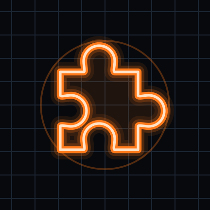
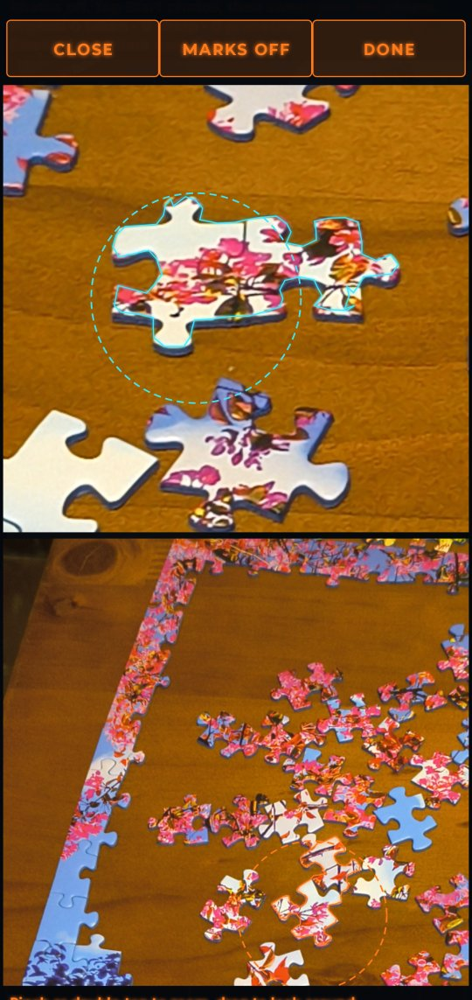

<p align="center"></p>

# Puzzler

An Android app that helps you build a jigsaw puzzle. Sweep the phone's camera over the loose
pieces on your table; Puzzler recognises each piece by its printed picture, works out where it
belongs on the box picture, and lists pieces that go next to each other, showing you where both
are lying on the table.

It is made for real conditions: pieces in a pile on a wooden table, warm light, camera at an
angle, no spreading pieces out and no holding the phone still.

## Quick start

1. Open Puzzler. The first time, a short guide walks you through the steps below.
2. **Take a reference photo** of the box picture and check its four corners.
3. Tap **Start photos** and slowly sweep the camera over your loose pieces.
4. Tap **Pairs**. Each entry shows two pieces that go together and where they are lying.
5. Join a pair, tap **Done**, and move on to the next one.

The rest of this guide explains each step in detail.

## How to use it

### The main screen

```
┌─────────────────────────────────────────────┐
│ Taking photos: just sweep over the pieces…  │  ← what the app is doing
│ Photos: 120 taken · 64 sharp · 58 processed │  ← progress (see below)
│ Catalogue: 212 pieces · 34 pair(s) …        │  ← what it has found
│                                             │
│          live camera view, with the         │
│          pieces of the last photo outlined  │
│                                             │
├────────┬────────┬────────────┬────────┬─────┤
│ LIGHT  │ ZOOM 1×│START PHOTOS│PAIRS(34)│  ?  │
└────────┴────────┴────────────┴────────┴─────┘
```

**Buttons**

| Button | What it does |
|---|---|
| **Light** | Turns the phone's torch on and off. Useful in dim light; it can also cause glare on glossy pieces. |
| **Zoom** | Steps through 1×, 2×, 3× and 5×. On many phones zoom only enlarges the image, so moving closer is usually better. |
| **Start photos / Stop photos** | The camera takes photos only while this is on. Photos are off when the app starts. Photos already taken keep being processed after you stop. |
| **Pairs (N)** | Opens the list of pairs; N is how many were found. |
| **?** | Opens the step-by-step guide again, including the reference photo. |

**The status lines**

- **taken**: photos the camera took.
- **sharp**: photos kept. Blurry photos, and photos taken while the phone was turning quickly, are thrown away. That's normal and nothing to worry about.
- **processed**: kept photos that have been analysed. **waiting** is how many are still in the queue. Up to 3 photos are analysed at once, so a backlog clears quickly once you pause.
- **➤ a little closer**: pieces were seen but are too small to measure. Move the phone closer, or zoom in.

**Outlines on the camera view** (from the most recent photo)

- **Cyan**: a piece the app outlined cleanly. The small number (×3) is how many photos it has been measured in.
- **Orange** with highlighted straight sides: an edge piece. **White** marked **C**: a corner piece.
- **Faint lines**: something piece-sized whose outline wasn't clean (often several touching pieces). These are still matched against the box picture, so they can still appear in pairs.

### 1. Take a reference photo of the box picture

Every piece is recognised by comparing its print with this photo, so it's worth doing well.

1. Lay the box flat with the picture facing up, in even light. Avoid reflections from a lamp on the glossy print.
2. Hold the phone **straight above** the box so the picture fills most of the screen.
3. Tap **Take reference photo** (from the guide, or **?** → Next) and hold still for a moment.
4. Puzzler marks the four corners it found. Drag the **cyan circles** onto the corners of the *picture* itself, not the edge of the box or a white border. A magnifier appears while you drag, so you can place them exactly.
5. Tap **Use this photo**. Preparing it takes a few seconds.

You only need to do this once per puzzle. Taking a new reference photo clears the pieces found so far, because their positions refer to the old one.

### 2. Sweep over the pieces

Tap **Start photos**, then move the phone over the table like a hand-held scanner.

- **Distance:** about 20–30 cm above the pieces. Each piece should be at least about a fingertip wide on screen; if the status says *a little closer*, move in.
- **Angle:** anything from straight down to a moderate tilt works. The app corrects for the tilt using the phone's motion sensors.
- **Speed:** slow and steady. You don't have to stop; photos taken mid-movement are simply discarded.
- **Coverage:** go over each area more than once, from different directions. A piece that wasn't recognised from one view is often recognised from another, and each extra view makes its placement more reliable.
- **Piles are fine:** you don't need to spread the pieces out. Pieces lying on top of others or touching each other are handled; only fully covered pieces can't be seen.
- **Light:** warm room light works. Avoid strong glare spots; tilting the phone a little usually moves them off the pieces.

Pieces with detailed print (flowers, buildings, trees, text) are recognised first and most reliably. Large plain areas, such as empty sky, are hard or impossible to place, because every such piece looks the same.

The phone plays a sound when new pairs are found. When you have covered the table, tap **Stop photos** and let the queue finish (the *waiting* count drops to zero).

### 3. Work through the pairs

Tap **Pairs**. At the top you'll see how many pairs are still to do, how many are done, and how many pieces have been placed on the box picture.

Each pair shows:

- **Two photo cut-outs**: where piece **A** (outlined in cyan) and piece **B** (outlined in orange) were lying when last photographed, with enough of the table around them to recognise the spot. A dashed ring surrounds the exact piece; this matters when the outline includes several touching pieces.
- **Row and column** of each piece on the box picture, counted from the top left. A and B are always next to each other.
- **A patch of the box picture** with both cells marked (cyan for A, orange for B), so you can see how they join and what they show.
- **Done**: tap it once you've joined the pair (or decided to skip it).

Pairs whose pieces are already joined on the table are left out automatically.

#### Looking closer

Tap a pair's photos to open them full screen:



- **Pinch** or **double-tap** to zoom; **drag** to look around. It opens already zoomed onto the pieces.
- When both pieces are in the same photo there is one picture; otherwise A is on top and B below.
- **Marks off** hides the outlines and rings so nothing covers the pieces; **Marks on** brings them back.
- **Done** marks the pair as done and closes the viewer; **Close** just closes it.

#### Done pairs

Done pairs move to a collapsed **Done** section at the end of the list, so the pairs still to do are always at the top. **Show done** expands it, and **Undo** puts a pair back in the list. Done pairs are remembered when you close the app.

### 4. After moving pieces

The cut-outs show where pieces were when they were photographed. Joining a few pairs doesn't matter, but after you've moved many pieces around (or added pieces from the box), start fresh:

1. Open **Pairs** and tap **Clear list (I moved the pieces)** at the top, then confirm.
2. Tap **Start photos** and sweep again.

Clearing forgets the found pieces, the pairs and the done marks. It keeps the reference photo, and it keeps the stored photos for testing on a laptop.

## Tips for the best results

- **Sweep twice** over the same area from different sides before checking the pairs. Most placements come from the second and third view of a piece.
- **Fill the screen with pieces**, not the table edge or the box. Photos with only a few pieces are processed quickly but add little.
- **Work by region of the picture.** Pairs come in clusters where the print is detailed, so it's often fastest to do all pairs of one area (say, the trees) together.
- **Check the box patch** before searching the table: it tells you what the two pieces look like and which sides join.
- **If a suggested pair doesn't fit**, mark it **Done** to move it out of the way. Wrong pairs are rare, and usually involve pieces with very similar print.

## Troubleshooting

| What you see | What to do |
|---|---|
| *Pairs (0)* after a long sweep | Check the reference photo (**?** → retake it). Pieces with plain print can't be placed; sweep areas with detailed print. Make sure the status doesn't say *a little closer*. |
| *0 sharp* while sweeping | Move more slowly, add light, or hold the phone steadier for a moment. |
| A large *waiting* count | Processing is behind your sweeping. That's fine: stop for a moment, or tap **Stop photos** and let it catch up. |
| The cut-out shows the wrong spot | The piece was moved after it was photographed. Sweep that area again, or clear the list after a big rearrangement. |
| *(a photo of this pair is no longer stored)* | The app keeps the newest 400 photos. Sweep that area again. |
| The box patch looks unrelated to the pieces | The reference photo's corners are off. Retake it and place the corners on the picture's corners. |

## What the app stores

Everything stays on the phone. Puzzler stores:

- the reference picture;
- the found pieces and pairs, and which pairs are done;
- the newest 400 photos it used, in the app's own storage, so the list can show where pieces were (and for testing on a laptop, see below).

Uninstalling the app removes all of it.

## Limitations

- Pairing comes from the box picture, so it needs a reference photo and only works for pieces
  whose print can be matched to it. Plain areas are not placed.
- The puzzle's grid is currently fixed at 40 × 25 pieces (a 1000-piece puzzle). Other sizes need
  a code change in `BoxPlacer`.
- The app takes photos at the highest resolution the phone offers to apps. Some phones keep
  their full-resolution sensor mode for their own camera app, so for small pieces hold the phone
  closer.
- Only arm64 phones are supported (the OpenCV native libraries are limited to `arm64-v8a`).

## Building

Requirements: JDK 21 and the Android SDK (platform 36). The Gradle wrapper is included.

```sh
export JAVA_HOME=/path/to/jdk-21
export ANDROID_HOME=/path/to/Android/Sdk   # or set sdk.dir in local.properties
./gradlew :app:assembleDebug
adb install -r app/build/outputs/apk/debug/app-debug.apk
```

Every push is built by GitHub Actions (`.github/workflows/build.yml`); the debug APK is attached
to each run as the `puzzler-debug-apk` artifact.

## Project layout

| Path | What it is |
|------|------------|
| `app/` | The Android app (CameraX capture, overlays, wizard, pairs list). |
| `core/` | Plain JVM Kotlin library with all image processing, shared by the app and the laptop tests. |
| `core/.../ScanSession.kt` | Everything done with one photo: square up the view using the gravity sensor, find pieces, catalogue them. |
| `core/.../TableSegmenter.kt`, `LivePipeline.kt` | Separating pieces from the table and from each other. |
| `core/.../BoxMap.kt`, `BoxPlacer.kt` | Placing pieces on the box picture by their print, and the pairs that follow. |
| `core/.../BoxLocator.kt` | The reference picture: corner detection and squaring up the box photo. |
| `scripts/pull-session.sh` | Copies the photos the phone took to `session/` for offline tests. |
| `scripts/watch-phone.sh` | Mirrors the phone's screen on the computer. |
| `ml/` | Python experiments (not used by the app). |

## Testing on a laptop

The app archives the photos it used. `scripts/pull-session.sh` copies them to `session/photos/`,
and the tests in `core/src/test` replay them through exactly the same code the phone runs:

```sh
PM_BENCH=base ./gradlew :core:test --tests '*BenchTest.bench'        # detection benchmark
PM_EXPORT=1 ./gradlew :core:test --tests '*BoxMapExportTest*'        # build the phone's box map
```

`BoxMapTest` needs no photos (it builds a synthetic box picture and table photos with a known
answer) and runs on every push in CI:

```sh
./gradlew :core:test --tests 'puzzlemaster.core.BoxMapTest'
```

Figures and reports are written to `test/`. The photos (`session/`, `core/src/test/resources/`)
are not in the repository, so these tests skip or fail without them.

## License

Copyright (C) 2026 Gabriel Ferreira

This program is free software; you can redistribute it and/or modify it under the terms of the
GNU General Public License as published by the Free Software Foundation; either version 2 of the
License, or (at your option) any later version.

This program is distributed in the hope that it will be useful, but WITHOUT ANY WARRANTY; without
even the implied warranty of MERCHANTABILITY or FITNESS FOR A PARTICULAR PURPOSE. See the
[GNU General Public License](LICENSE) for more details.

Third-party parts keep their own licenses: OpenCV and the AndroidX/CameraX libraries are
Apache-2.0. The launch sound (`app/src/main/assets/sounds/theme.m4a`) is a sample of a
third-party track and is not covered by this license.
